EasyVNA
=======

**One-tap LoRa antenna tuning (433 / 869 / 915 MHz) for the NanoVNA-H4.**
A firmware fork of [DiSlord's NanoVNA-D](https://github.com/DiSlord/NanoVNA-D),
by PiX (and the Claude, OpenAI and Deepseek AI band).

| | |
|:---:|:---:|
| 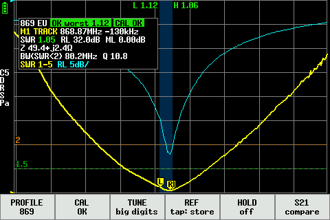 | 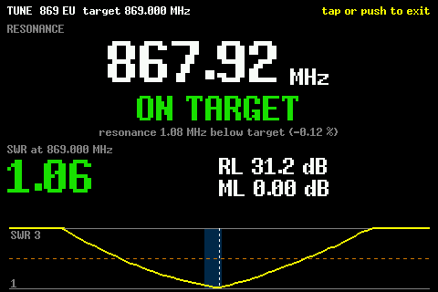 |
| 869 MHz profile: SWR + return loss, band edges, info block, action bar | TUNE: shorten / lengthen in big digits |
| 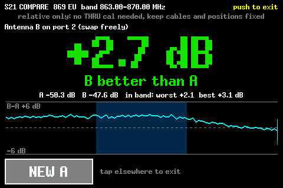 | 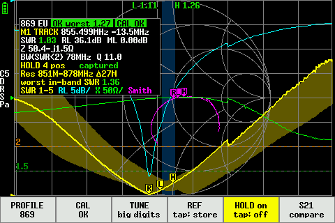 |
| S21 COMPARE: antenna B vs antenna A | HOLD: SWR envelope over antenna positions |

## Why EasyVNA

- **One tap to a calibrated LoRa band** instead of menu diving: pick 433, 869, 915, WIDE or SURVEY
  at power on or from the action bar; each band keeps its own calibration slot.
- **See at a glance if the antenna is in band**: shaded ISM band, SWR at the band edges
  (L / H markers), an OK / ~OK / BAD chip with the worst in-band SWR, SWR 1.5 / 2.0 guide lines.
- **Big-digit TUNE** shows the resonance and tells you to SHORTEN or LENGTHEN by how many percent.
- **Compare two antennas over S21** against a fixed reference antenna, no THRU calibration needed.
- **HOLD shows how much bending or handling detunes the antenna** (resonance spread over the
  positions you hold it in).
- **Fake / open / shorted antenna warnings** (NO ANT/OPEN?, SHORT?, LOSSY?).
- **Flash over USB with no button juggling**: `reset dfu` really enters the ROM bootloader.

> [!WARNING]
> **This fork was developed with Claude (Anthropic's AI assistant, via Claude Code) under the
> direction of PiX.** Code, docs and screenshots were largely AI-generated and tested on a single
> NanoVNA-H4; use at your own risk. Not affiliated with or endorsed by DiSlord / edy555.
> GPL-3.0 like upstream.

## Features

All of this is on top of NanoVNA-D; the stock menus stay reachable (short push on the jog wheel,
or a tap on an empty part of the plot).

- **Profiles**: WIDE (300 MHz - 1 GHz), SURVEY (50 MHz - 1.5 GHz), 433 ISM, 869 EU, 915 US, plus
  CUSTOM (your own saved setup). Each profile recalls its own calibration slot (1 = SURVEY,
  2 = CUSTOM, 3..6 = WIDE/433/869/915; slot 0, the stock power-on slot, is left alone).
- **Power-on chooser** on the splash screen: starts the last profile after 3 s (jog / touch to pick
  another); after flashing a new build it waits for a choice.
- **Action bar** (bottom of the profile screen): `PROFILE`, `CAL`, `TUNE`, `REF`, `HOLD`, `S21`.
  Double-tap an empty part of the plot to hide / show it (the plot gets its full height back).
- **QUICK CAL wizard**: full screen OPEN -> SHORT -> LOAD, saved to the profile's slot; CANCEL
  restores the saved calibration. The CAL button turns red / yellow when the profile is not
  calibrated (or calibrated for another range).
- **Info block**: resonance and offset from the band centre, SWR (colour coded), return loss,
  mismatch loss, Z, SWR<2 bandwidth and Q, pass/fail and calibration chips. Drag it anywhere;
  a tap on its legend line cycles the view (SWR+RL / SWR+Smith / all).
- **Markers**: M1 tracks the SWR minimum (R) or stays where you put it (FREE, a long jog press
  toggles); L / H markers on the ISM band edges with their SWR at the top of the plot.
- **Autoscale** of SWR / return loss / reactance after every sweep; SWR drawn bold.
- **TUNE**: big digits on a fast 101-point sweep, SHORTEN / LENGTHEN x.x %, SWR / RL / ML at the
  band centre, "no dip in range" warning, REF comparison.
- **REF**: store the current S11 (e.g. before cutting, or in free air), drawn as a grey curve with
  the resonance shift and SWR change since then. Also works as a detuning test (free air vs hand /
  enclosure).
- **HOLD**: bend or move the antenna, hold it still, repeat: each still position (3 agreeing sweeps,
  averaged) is added to a min/max SWR envelope; sweeps taken while moving are rejected. Shows the
  resonance spread and the worst in-band SWR over all positions.
- **S21 COMPARE**: port 1 to a fixed reference antenna, port 2 to the antenna under test; store
  antenna A, swap to B, read the in-band difference in dB (relative only, no THRU calibration).
- **SURVEY / WIDE**: lists up to three dips with the nearest LoRa band.
- **Sanity flags**: NO ANT/OPEN? and SHORT? (|S11| > 0.95 everywhere), LOSSY? (flat low SWR with
  little reactance over a wide sweep).
- **USB DFU fix**: `reset dfu` now resets the MCU and enters the ROM bootloader with the USB
  re-enumerating as 0483:df11 (on stock it froze on the DFU screen).
- **Crash log**: a HardFault stores PC/LR/fault registers and reboots instead of hanging; the
  splash shows a red line and the `fault` shell command prints the record.

### More screenshots

| | |
|:---:|:---:|
| 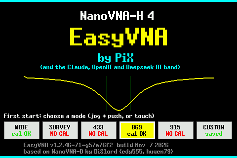 | 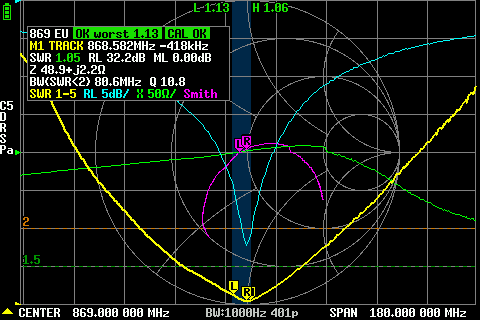 |
| Power-on chooser | 869 profile, all traces (SWR, RL, X, Smith) |
| 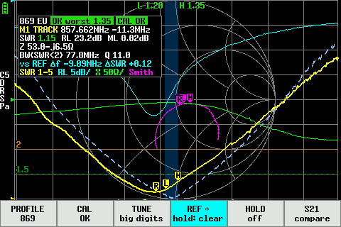 |  |
| REF overlay | SURVEY with the dip list |
| 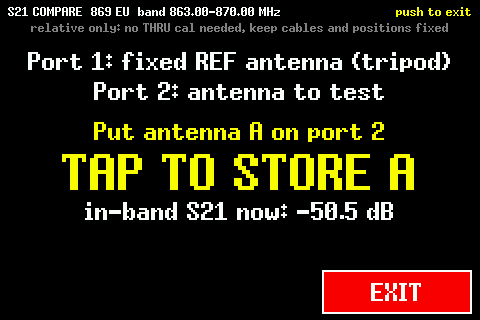 | 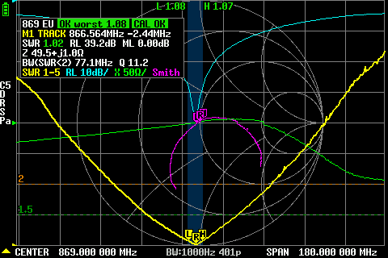 |
| S21 COMPARE, step 1 | Action bar hidden (double-tap) |
| 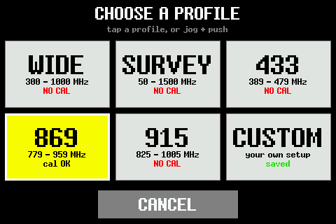 | 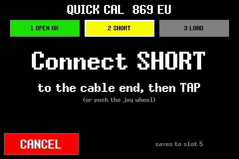 |
| PROFILE chooser *(emulator render)* | QUICK CAL wizard *(emulator render)* |

Screenshots are real `capture` dumps from a NanoVNA-H4 unless marked *emulator render* (the
firmware's own drawing code run under qemu with real sweep data).

## Hardware

**NanoVNA-H4 only** (STM32F303, 480x320). The NanoVNA-H (STM32F072) build still compiles but without
the EasyVNA features: they do not fit its flash.

## Build and flash

Build as described below (upstream section), for the H4:

    make TARGET=F303

The image is `build/H4.bin`.

**Flash over USB**: in the USB serial shell (any terminal, 115200) type `reset dfu`, or use the
menu CONFIG > DFU, then:

    dfu-util -d 0483:df11 -a 0 -s 0x08000000:leave -D build/H4.bin

**First install / recovery**: stock NanoVNA-D firmware freezes on the DFU screen after `reset dfu`
without enumerating. Power the H4 off, hold the jog wheel pushed in while switching it on: it starts
in the ROM DFU mode (USB 0483:df11, the screen does not show the normal UI). Then run the same
`dfu-util` command.

Your configuration and calibration slots are kept. After a new build is flashed, the power-on
chooser waits for you to pick a profile; uncalibrated profiles show NO CAL: tap CAL.

## Shell protocol (`profile` command)

Lines are space separated, frequencies in Hz. The web tool parses these formats.

| Command | Output |
|---|---|
| `profile` | `<name> <start> <stop> <points> <slot> <cal 0/1> <active 0/1>` per profile, `custom ...`, `boot <name> ask=<0/1>`, `view <name>` |
| `profile <wide\|433\|869\|915\|survey\|custom>` | applies it (or answers an open chooser), prints its line |
| `profile view [rl\|smith\|all]` | `view <name>` |
| `profile info` | `res <f> <swr> <rl_db> <ml_db> <r> <x>`, `bw <hz> <open>`, `q <q>`, `worst <swr\|-1>`, `flag <ok\|open\|short\|lossy>`, `dip <f> <swr> <band_mhz>` (WIDE/SURVEY), then the ref / hold / compare / tune lines |
| `profile ref [store\|clear]` | `ref <valid> <f_res> <swr> <bw>` |
| `profile tune [on\|off]` | `tune 0` or `tune 1 <target> <f_res> <swr_at_target> <offset_pct>` |
| `profile hold [on\|off]` | `hold <on> <positions> <state> <res_min> <res_max> <worst_inband_swr>` |
| `profile hold data` | `<f> <swr_min> <swr_max>` per point |
| `profile compare [on\|store\|new\|off]` | `compare <state> <a_valid> <avgA_db> <avgB_db> <delta_db> <worst_db> <best_db>` |
| `profile bar [show\|hide]` | `bar <show\|hide>` |
| `fault [clear]` | `fault none` or `fault pc ... lr ... psr ... cfsr ... hfsr ... bfar ... mmfar ... sp ... exc ...` |

## Status

Exercised on one NanoVNA-H4 with real antennas: profiles and the power-on chooser, TUNE, REF,
HOLD, S21 COMPARE, the `profile` shell protocol and USB DFU flashing (`reset dfu` + dfu-util).
The QUICK CAL wizard and the touch / jog handling (double-tap timing, long press, drags) were only
tried on that single unit. The HOLD motion threshold and the SURVEY / LOSSY thresholds were set from
a few real sweeps and may need adjusting for other antennas.

## License

The firmware as a whole is GPL-3.0 (inherited from NanoVNA-D), see [LICENSE](LICENSE).
EasyVNA's own new files (`vna_modules/vna_profiles.c`, `vna_lora_plot.c`, `vna_lora_screens.c`,
`vna_splash.c`) are BSD-3-Clause (see their headers and [LICENSE-BSD](LICENSE-BSD)) and can be
reused under BSD on their own. EasyVNA changes to upstream files keep the upstream GPL headers.

## Credits

- [DiSlord](https://github.com/DiSlord/NanoVNA-D): NanoVNA-D firmware, which EasyVNA is built on.
- [edy555](https://github.com/ttrftech/NanoVNA): the original NanoVNA and its firmware.
- hugen79: NanoVNA-H / H4 hardware.
- EasyVNA by PiX (and the Claude, OpenAI and Deepseek AI band).

---

*The original NanoVNA-D README follows.*

NanoVNA - Very tiny handheld Vector Network Analyzer
==========================================================
[release]: https://github.com/DiSlord/NanoVNA-D/releases

<div align="center">

</div>

# About

**NanoVNA-H** and **NanoVNA-H4** are very tiny handheld Vector Network Analyzers (VNA).
They are standalone portable devices withLCD and battery.
This project aims to provide improved firmware for this useful instrument for enthusiast.

This repository contains the source code of the improved NanoVNA-H and NanoVNA-H4 firmware.

The documentation describes the build and flash process on a MacOS or a Linux (Debian or Ubuntu) system, other Linux (or even BSD) systems may behave similar.

## Prepare ARM Cross Tools

**UPDATE**: Recent gcc version works to build NanoVNA, no need to use old version.

### MacOSX

Install cross tools and firmware updating tool.

    brew tap px4/px4
    brew install gcc-arm-none-eabi-80
    brew install dfu-util

### Linux (ubuntu)

Download arm cross tools from [here](https://developer.arm.com/tools-and-software/open-source-software/developer-tools/gnu-toolchain/gnu-rm/downloads).

    wget https://developer.arm.com/-/media/Files/downloads/gnu-rm/8-2018q4/gcc-arm-none-eabi-8-2018-q4-major-linux.tar.bz2
    sudo tar xfj gcc-arm-none-eabi-8-2018-q4-major-linux.tar.bz2 -C /usr/local
    PATH=/usr/local/gcc-arm-none-eabi-8-2018-q4-major/bin:$PATH
    sudo apt install -y dfu-util

### Debian

    sudo apt install gcc-arm-none-eabi
    sudo apt install -y dfu-util

## Fetch Source Code

Fetch the firmware source and the submodule, do this once to initialize your local clone from GitHub:

    git clone https://github.com/DiSlord/NanoVNA-D.git
    cd NanoVNA-D
    git submodule update --init --recursive

## Update Source Code

To get updates from the GitHub repository, go to your `NanoVNA-D` directory and type:

    git pull

## Build the NanoVNA-H Firmware

Go to your `NanoVNA-D` directory and type:

    export TARGET=F072
    make clean
    make

## Build the NanoVNA-H4 Firmware

Go to your `NanoVNA-D` directory and type:

    export TARGET=F303
    make clean
    make

## Flash Firmware

When the build of your firmware is finished, you can flash it onto your NanoVNA device.
First, let the device enter DFU mode by one of following methods.

* Open the device and jumper `BOOT0` pin to `Vdd` pin when powering the device.
* Select menu Config->DFU (needs recent firmware).
* Press the jog switch on your -H4 when powering the device.

Then, flash the firmware using `dfu-util` via USB.

#### For NanoVNA-H:

Go to your `NanoVNA-D` directory and type:

    dfu-util -d 0483:df11 -a 0 -s 0x08000000:leave -D build/H.bin

#### For NanoVNA-H4:

Go to your `NanoVNA-D` directory and type:

    dfu-util -d 0483:df11 -a 0 -s 0x08000000:leave -D build/H4.bin

#### Or simply type directly after building the firmware (for both variants).

Go to your `NanoVNA-D` directory and type:

    make flash

#### Ignore the apparent error message during flashing

The low-level tool `dfu-util` displays a lot of information that is very useful especially for developers, but can confuse the user.
In particular, please ignore the message about corrupt firmware, this is the normal behaviour of the unit before clearing the status.
It is important to note that after clearing the status, there is no longer an error condition present.

```
...
Determining device status...
DFU state(10) = dfuERROR, status(10) = Device's firmware is corrupt. It cannot return to run-time (non-DFU) operations
Clearing status
Determining device status...
DFU state(2) = dfuIDLE, status(0) = No error condition is present
...
```

## Companion Tools

There are several numbers of great companion PC tools from third-party.

* [NanoVNA-App software](https://github.com/OneOfEleven/NanoVNA-H/blob/master/Release/NanoVNA-App.rar) by OneOfEleven
* [NanoVNASharp Windows software](https://drive.google.com/drive/folders/1IZEtx2YdqchaTO8Aa9QbhQ8g_Pr5iNhr) by hugen79
* [NanoVNA WebSerial/WebUSB](https://github.com/cho45/NanoVNA-WebUSB-Client) by cho45
* [Android NanoVNA app](https://play.google.com/store/apps/details?id=net.lowreal.nanovnawebapp) by cho45
* [NanoVNASaver](https://github.com/NanoVNA-Saver/nanovna-saver) by mihtjel and the members of NanoVNA-Saver
* [TAPR VNAR4](https://groups.io/g/nanovna-users/files/NanoVNA%20PC%20Software/TAPR%20VNA) supports NanoVNA by erikkaashoek
* [The NanoVNA toolbox](https://github.com/Ho-Ro/nanovna-tools) by Ho-Ro
* see [python](/python/README.md) directory to use NanoVNA with Python and Jupyter Notebook.

## Documentation

* [NanoVNA User Guide(ja)](https://cho45.github.io/NanoVNA-manual/) by cho45. [(en:google translate)](https://translate.google.com/translate?sl=ja&tl=en&u=https%3A%2F%2Fcho45.github.io%2FNanoVNA-manual%2F)
* [NanoVNA user group](https://groups.io/g/nanovna-users/topics) on groups.io.

## Reference

* [Schematics](/doc/nanovna-sch.pdf)
* [PCB Photo](/doc/nanovna-pcb-photo.jpg)
* [Block Diagram](/doc/nanovna-blockdiagram.png)
* Kit available from https://ttrf.tk/kit/nanovna

## Note

Hardware design material is disclosed to prevent bad quality clone. Please let me know if you would have your own unit.

## Credit
* [@DiSlord](https://github.com/DiSlord/)

## Based on code from:
* [@edy555](https://github.com/edy555)

### Contributors
* [@OneOfEleven](https://github.com/OneOfEleven)
* [@hugen79](https://github.com/hugen79)
* [@cho45](https://github.com/cho45)

